# Sattle Architecture

```mermaid
flowchart TD
    %% ── Styling ──
    classDef entry fill:#4a90d9,stroke:#2c5f8a,color:#fff
    classDef endpoint fill:#5ba85b,stroke:#3d7a3d,color:#fff
    classDef handler fill:#e8a838,stroke:#b8841c,color:#fff
    classDef task fill:#d95b5b,stroke:#a33c3c,color:#fff
    classDef cpp fill:#9b59b6,stroke:#7d3c98,color:#fff
    classDef external fill:#95a5a6,stroke:#7f8c8d,color:#fff
    classDef cache fill:#1abc9c,stroke:#16a085,color:#fff
    classDef config fill:#f0f0f0,stroke:#bbb,color:#333

    %% ════════════════════════════════════════════
    %%  ENTRY POINTS
    %% ════════════════════════════════════════════
    subgraph ENTRY["Entry Points"]
        APP["bin.src/app.py"]:::entry
        CLIENT["bin.src/example_client.py"]:::entry
    end

    APP -->|"starts"| SERVER

    %% ════════════════════════════════════════════
    %%  WEB SERVER
    %% ════════════════════════════════════════════
    subgraph SERVER["aiohttp Web Server :9999"]
        direction TB
        HEALTH["/health  GET"]:::endpoint
        VISIT_PUT["/visit_cache  PUT"]:::endpoint
        VISIT_GET["/visit_cache  GET"]:::endpoint
        DIASOURCE["/diasource_allow_list  PUT"]:::endpoint
    end

    %% ════════════════════════════════════════════
    %%  BACKGROUND LOOPS
    %% ════════════════════════════════════════════
    subgraph BACKGROUND["Background Tasks  (async)"]
        TLE_UPDATE["tle_update()\nevery ~7 days"]:::handler
        CACHE_CLEANUP["cache_update()\nexpire after 30 min"]:::handler
    end

    SERVER -.->|"on_startup"| TLE_UPDATE
    SERVER -.->|"on_startup"| CACHE_CLEANUP

    %% ════════════════════════════════════════════
    %%  HANDLERS
    %% ════════════════════════════════════════════
    HEALTH -->|"runs"| SELF_TEST["Self-Test\n(fixed TLE + JD)"]:::handler
    VISIT_PUT -->|"calls"| VISIT_HANDLER["visit_handler()"]:::handler
    VISIT_GET -->|"reads"| CACHE
    DIASOURCE -->|"calls"| DIASOURCE_HANDLER["diasource_handler()"]:::handler

    %% ════════════════════════════════════════════
    %%  CORE PYTHON TASKS
    %% ════════════════════════════════════════════
    subgraph SATTLEPY["sattlePy.py — Core Tasks"]
        direction TB
        SATTLE_TASK["SattleTask.run()\nCompute satellite positions\nfor an exposure"]:::task
        FILTER_TASK["SattleFilterTask.run()\nFilter diasources by\nsatellite track intersection"]:::task
    end

    VISIT_HANDLER -->|"instantiates"| SATTLE_TASK
    DIASOURCE_HANDLER -->|"instantiates"| FILTER_TASK

    %% ════════════════════════════════════════════
    %%  CACHE
    %% ════════════════════════════════════════════
    CACHE[("visit_satellite_cache\n{visit_id: positions}")]:::cache
    SATTLE_TASK -->|"writes"| CACHE
    DIASOURCE_HANDLER -->|"reads sat positions"| CACHE
    CACHE_CLEANUP -->|"evicts old entries"| CACHE

    %% ════════════════════════════════════════════
    %%  TLE SOURCES
    %% ════════════════════════════════════════════
    subgraph TLE_SOURCES["TLE Acquisition"]
        direction TB
        READ_TLES["read_tles()"]:::handler
        MERGE["merge_and_deduplicate_catalogs()\npick TLE closest to target date"]:::handler
        READ_TLES --> MERGE
    end

    SATTLE_TASK -->|"fetches TLEs"| READ_TLES
    TLE_UPDATE -->|"refreshes"| READ_TLES

    subgraph EXTERNAL["External TLE Sources"]
        direction TB
        SPACETRACK["space-track.org\n catalogs"]:::external
        SATCHECKER["satchecker\n(iau.noirlab)"]:::external
        TLE_FILE["Local TLE file"]:::external
    end

    subgraph PULL_CATALOG["pullCatalog.py"]
        SATCAT["SatCatFetcher\nauthenticate + fetch"]:::handler
    end

    READ_TLES -->|"'catalog'"| SATCAT
    READ_TLES -->|"'satchecker_query'"| SATCHECKER
    READ_TLES -->|"'tle_file'"| TLE_FILE
    SATCAT -->|"requests"| SPACETRACK

    %% ════════════════════════════════════════════
    %%  C++ LAYER
    %% ════════════════════════════════════════════
    subgraph CPP["C++ Layer  (pybind11 — sattle.so)"]
        direction TB
        PARSE["parse_elements(line1, line2)\nTLE string → TleType struct\n(supports Alpha-5)"]:::cpp
        CALC["calc_sat(Inputs, TleType) → Outputs\nSGP4/SDP4 orbit propagation\n→ RA/Dec at obs times"]:::cpp
        INPUTS["Inputs struct\nlat, lon, ht, jd[2],\nsearch_radius, target_ra/dec"]:::cpp
        OUTPUTS["Outputs struct\nra[2], dec[2]"]:::cpp
    end

    SATTLE_TASK -->|"for each TLE"| PARSE
    PARSE --> CALC
    CALC --> OUTPUTS
    SELF_TEST -->|"validates"| CALC

    subgraph GRAY["Bill Gray Libraries"]
        SAT_CODE["sat_code\nSGP4/SDP4 propagation"]:::external
        LUNAR["lunar\nEarth location utils"]:::external
    end

    CALC -->|"calls"| SAT_CODE
    CALC -->|"calls"| LUNAR

    %% ════════════════════════════════════════════
    %%  SPHERICAL GEOMETRY (Filter path)
    %% ════════════════════════════════════════════
    subgraph GEOMETRY["Spherical Geometry  (lsst.sphgeom)"]
        direction TB
        TRACKS["satellite_tracks()\n→ ConvexPolygon per track"]:::task
        BBOX["calc_bbox_sph_coords()\ndiasource bbox → ConvexPolygon"]:::task
        CHECK["_check_tracks()\nbbox.intersects(track)?"]:::task
        TRACKS --> CHECK
        BBOX --> CHECK
    end

    FILTER_TASK --> TRACKS
    FILTER_TASK --> BBOX
    CHECK -->|"non-intersecting IDs"| ALLOW_LIST["allow_list\n(clean diasource IDs)"]:::cache

    %% ════════════════════════════════════════════
    %%  LOGGING
    %% ════════════════════════════════════════════
    subgraph LOGGING["Logging  (constants.py)"]
        direction LR
        CTX["ContextFilter\ninject visit_id,\ndetector_id"]:::config
        UTC["UTCFormatter"]:::config
        CONSOLE["Console Handler"]:::config
        FILELOG["TimedRotatingFileHandler\n(daily UTC rollover)"]:::config
    end

    SERVER -.->|"all requests"| LOGGING

    %% ════════════════════════════════════════════
    %%  CONFIG
    %% ════════════════════════════════════════════
    subgraph CONFIG["Configuration"]
        direction LR
        SC["SattleConfig\ndetector_radius: 6300″\npsf: 0.5″\nsearch_buffer: 480″/s"]:::config
        SFC["SatelliteFilterConfig\ntrack_width: 0.01°\npsf_multiplier: 2.0"]:::config
    end

    CONFIG -.-> SATTLE_TASK
    CONFIG -.-> FILTER_TASK

    %% ════════════════════════════════════════════
    %%  DOCKER
    %% ════════════════════════════════════════════
    subgraph DOCKER["Docker / Apptainer"]
        direction LR
        BUILD["Builder stage\ncompile sattle.so"]:::external
        TEST["Test stage\npytest validation"]:::external
        RUNTIME["Runtime image\nPython 3.11-slim\nport 9999"]:::external
        BUILD --> TEST --> RUNTIME
    end

    DOCKER -.->|"runs"| APP

    %% ════════════════════════════════════════════
    %%  ENV VARS
    %% ════════════════════════════════════════════
    ENV["Environment Variables"]:::config
    ENV -.-> SATCAT
```

## Legend

| Color | Meaning |
|-------|---------|
| Blue | Entry points |
| Green | HTTP endpoints |
| Orange | Handler / orchestration functions |
| Red | Core computation tasks |
| Purple | C++ layer (pybind11) |
| Gray | External services & libraries |
| Teal | Cache / data stores |
| Light gray | Configuration & logging |

## Data Flow Summary

1. **Visit request** arrives at `/visit_cache` → `visit_handler()` → `SattleTask` fetches TLEs, calls C++ `calc_sat()` for each satellite, caches positions per visit.
2. **Diasource request** arrives at `/diasource_allow_list` → `diasource_handler()` reads cached positions → `SattleFilterTask` builds satellite track polygons, tests intersection with each diasource bounding box → returns IDs of clean (non-contaminated) sources.
3. **Background loops** keep TLEs fresh (~7 day refresh) and expire stale cache entries (30 min TTL).
